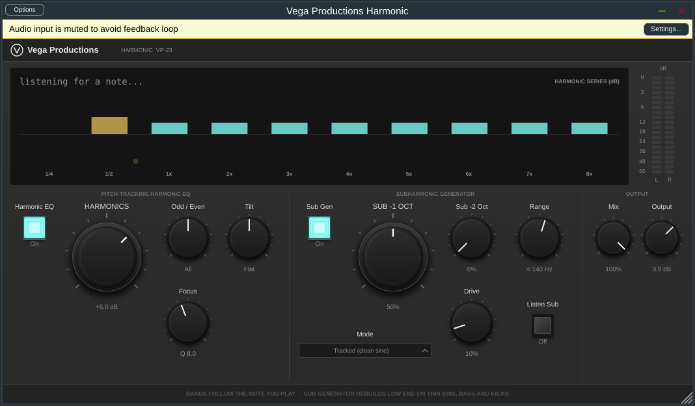

# Vega Productions Harmonic (VP-23)

A pitch-tracking harmonic EQ and a subharmonic generator in one: shape the harmonic series of whatever note is playing, and rebuild deep low end under thin 808s, basses and kicks.



## Download
- **Windows (FL Studio):** https://github.com/DJVega70/vega-harmonic/releases/latest/download/VegaProductions-Harmonic-Windows-VST3.zip
- **macOS:** https://github.com/DJVega70/vega-harmonic/releases/latest/download/VegaProductions-Harmonic-macOS-VST3-AU.zip

## Pitch-tracking harmonic EQ
A pitch tracker (30 Hz – 1.2 kHz) follows the note and places 8 bands exactly on its harmonics (1×…8×), moving with every note change.
- **Harmonics** ±18 dB — boost for richness and presence, cut for a purer, rounder tone.
- **Odd / Even** — odd = hollow/square-like, even = warm/octave-rich.
- **Tilt** — favour the low or the high harmonics.
- **Focus** — band width (higher = only the harmonics, leaving everything between untouched).
When no clear note is found, the EQ relaxes to flat so nothing rings at a stale pitch.

## Subharmonic generator
- **Sub −1 Oct** and **Sub −2 Oct** levels, **Range** (only notes below this get a sub), **Drive** for grit.
- **Tracked (clean sine)** — pure sines locked to the tracked pitch, ideal for 808s and sub bass.
- **Divider (warm)** — the classic octave-divider circuit sound (dbx 120 style), follows anything with low end, including kicks.
- **Listen to Sub** solos the generated sub so you can tune it.

Mix and Output. The sub follows the input's envelope and stops when the input stops.

## Building
```
cmake -B build -DVEGA_TESTS=ON
cmake --build build --config Release --target VegaHarmonic_VST3 VegaHarmonicTest
```
